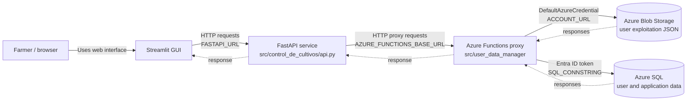

# Control de Cultivos

Control de Cultivos is a digital system for managing farm and campaign information in the context of the European Common Agricultural Policy (CAP). Its user interface is built with Streamlit, and its application API and Azure integration are separate services.

## Architecture and cloud access boundary

**Azure cloud resources must be accessed exclusively through the Azure Functions proxy.** The Streamlit application and the FastAPI service send requests to that proxy; they must not connect directly to Azure Storage or Azure SQL or hold credentials for those services. The Function app owns the cloud connection configuration and uses its Azure identity to access the resources.

This is the application's access design. Enforce it in each deployment with appropriate Azure identity permissions and, where required, network restrictions; the application code alone does not impose a network-level boundary.



In a typical request:

1. The farmer interacts with the Streamlit GUI.
2. The GUI's server sends an HTTP request to FastAPI (by default, `http://127.0.0.1:8001`).
3. FastAPI forwards the request to the Azure Functions HTTP endpoint.
4. The Function reads or writes Azure Blob Storage or Azure SQL and returns the result through FastAPI to the GUI.

The Function app uses `DefaultAzureCredential` for Azure identity. It reads `ACCOUNT_URL` and `SQL_CONNSTRING` from its environment. Set `AZURE_FUNCTIONS_BASE_URL` for FastAPI (defaults to `http://127.0.0.1:7071/api`) and `FASTAPI_URL` for the GUI (defaults to `http://127.0.0.1:8001`). Keep cloud credentials out of the GUI and FastAPI environments.

## Components

| Component | Responsibility |
| --- | --- |
| `src/control_de_cultivos/` | Streamlit GUI, pages, shared application code, and the FastAPI service. |
| [`src/control_de_cultivos/api.py`](src/control_de_cultivos/api.py) | FastAPI endpoints for health checks and proxying requests to Azure Functions. It does not access Azure Storage or Azure SQL directly. |
| `src/user_data_manager/src/user_data_manager/function_app.py` | Azure Functions HTTP triggers for health checks, exploitation data, user data, and database metadata. |
| `src/user_data_manager/src/user_data_manager/support/cloud.py` | Azure Blob Storage and Azure SQL clients used by the Function app. |
| `src/database/` | Azure SQL schema, stored procedure, and query scripts (described below). |
| `pyproject.toml` | Main Python project and `uv` configuration. |

## Communication interfaces

The GUI talks to FastAPI, not directly to the Azure Function or Azure resources. FastAPI's proxy routes below make the corresponding Function app calls.

| FastAPI method and path | Parameters | Purpose |
| --- | --- | --- |
| `GET /health?level=0` | Optional `level` (defaults to `1`) | Basic FastAPI health response. `level=1` also checks the Function app's `/health` endpoint. |
| `GET /api/status` | — | Returns service and configured port information. |
| `GET /proxy/user_data/explotations` | `user`, `userKey`, optional `check` (defaults to `0`) | Lists a user's exploitation blobs. |
| `GET /proxy/user_data/explotation` | `user`, `userKey`, `explotation`, optional `check` (defaults to `0`) | Reads one exploitation JSON blob. |
| `GET /proxy/user_data/user_info` | `user` | Retrieves a user's SQL record. |
| `POST /proxy/user_data/insert_new_user` | JSON body containing `user_data` | Inserts a user record. |
| `GET /proxy/generaldb/get_table_struct` | `table_name` | Retrieves SQL table/column metadata. |
| `GET /proxy/generaldb/get_column_uniques` | `table_name`, `column_name` | Retrieves distinct values for a table column. |

The FastAPI service forwards these requests to Function routes such as `/get_explotations_list`, `/get_explotation_data`, `/get_user_data`, `/insert_new_user`, `/get_table_structure`, and `/get_column_uniques`. Local Azure Functions Core Tools endpoints are typically prefixed with `/api` (for example, `http://127.0.0.1:7071/api/health`).

## Database scripts and data

The scripts in [`src/database/`](src/database/) target Azure SQL:

| File | Purpose |
| --- | --- |
| [`0_users.sql`](src/database/0_users.sql) | Creates `01_users` and `01_users_history`. The current user table includes identity and timestamp fields, a unique `code`, unique `email`, name, province, exploitation count, blocked-account fields, and data-processing-permission (DPP) fields. The history table stores timestamped user snapshots. **This script drops and recreates both tables; back up any data before running it.** |
| [`procedures.sql`](src/database/procedures.sql) | Defines generic insert, update, and restore procedures. Updates write a snapshot to the related history table; restore reapplies the latest saved version. |
| [`consulting.sql`](src/database/consulting.sql) | Example query that selects rows from `01_users`. |
| [`db_README.md`](src/database/db_README.md) | Additional database purpose and configuration notes. |

User and application records are stored in Azure SQL. Exploitation JSON files are stored separately in Azure Blob Storage, in a per-user container (`user-{user}`) under the `exploitations/` path. The Function app implements access to both stores. To initialize a new database, review the SQL files first, run `0_users.sql`, and then install `procedures.sql`.

## Local development

### Prerequisites

- Python version and dependencies declared in the root and Function app `pyproject.toml` files.
- `uv` for dependency management.
- Azure Functions Core Tools for running the local Function app.
- Azure SQL and Azure Storage resources, with appropriate permissions for the identity used by the Function app.

Install the main project's dependencies:

```bash
uv sync
```

Configure the environment variables for the appropriate services:

| Variable | Used by | Default / purpose |
| --- | --- | --- |
| `FASTAPI_URL` | Streamlit GUI | `http://127.0.0.1:8001` |
| `FASTAPI_PORT` | FastAPI launcher | `8001` |
| `STREAMLIT_PORT` | Streamlit launcher | `8000` |
| `AZURE_FUNCTIONS_BASE_URL` | FastAPI | `http://127.0.0.1:7071/api` |
| `ACCOUNT_URL` | Azure Functions | Azure Storage account URL. |
| `SQL_CONNSTRING` | Azure Functions | Azure SQL connection string; authentication uses the Function app's Azure identity. |

For local Function development, authenticate the Azure identity used by `DefaultAzureCredential` (for example, with Azure CLI) and provide the Function app's cloud configuration in its local environment. For deployment, configure those settings and grant the Function app identity the required Storage and SQL permissions. Do not put cloud credentials in the Streamlit or FastAPI configuration.

### Run the application

Start the Streamlit GUI and FastAPI service:

```bash
uv run cultivos
```

The GUI defaults to port `8000`; FastAPI defaults to port `8001`.

In a separate terminal, start the local Azure Functions proxy:

```bash
cd src/user_data_manager
uv run user-manager
```

The Function app defaults to port `7071` when run with Azure Functions Core Tools. Set `AZURE_FUNCTIONS_BASE_URL` if it is running at a different address.

## Further documentation

- [`src/control_de_cultivos/api_README.MD`](src/control_de_cultivos/api_README.MD) — FastAPI endpoint examples.
- [`src/user_data_manager/README.md`](src/user_data_manager/README.md) — Azure Function endpoint examples.

---

Contributions are welcome through issues and pull requests. Please follow the existing project style and the CI workflow in `.github/workflows/main_controldecultivos.yml`.
